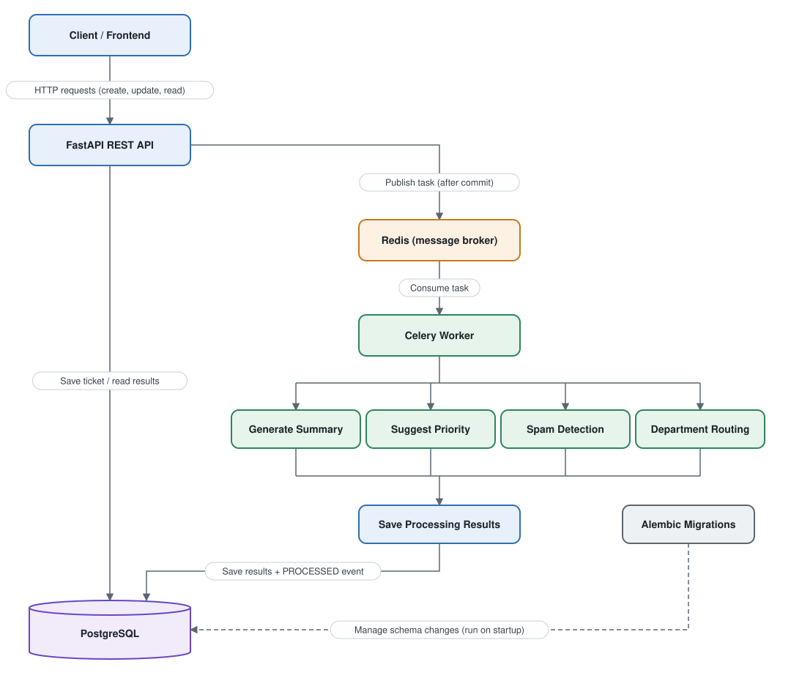

# Design notes

The reasoning behind how the service is built. For setup and usage, see the [README](../README.md).



The diagram source is [support-ticket-architecture.drawio](architecture/support-ticket-architecture.drawio); open it in [diagrams.net](https://app.diagrams.net) to edit.

## Request flow

1. The client calls the FastAPI app. Every request gets an `X-Request-ID`, which is added to all log lines for that request.
2. Creating a ticket saves three rows in one transaction: the ticket, its processing row (`PENDING`) and a `CREATED` event.
3. After the commit, the API puts the ticket id on a Redis queue. The commit has to come first, or the worker could look for a ticket that isn't saved yet.
4. A Celery worker picks up the job, analyzes the ticket and saves the results to `ticket_processing`, plus a `PROCESSED` event.
5. The client reads the ticket again and sees the results.

If Redis is down at step 3, the ticket is still saved and the request still succeeds, but the ticket stays `PENDING`. That's a known gap (see the outbox pattern in the README).

## Layers

```
app/api/            routes, dependencies, error handlers
app/services/       business rules and transactions
app/repositories/   SQL queries
app/models/         SQLAlchemy models
app/schemas/        request and response models (Pydantic)
app/worker/         Celery app and tasks
```

- Routes only deal with HTTP: parse input, call a service, return a response model.
- Services hold the rules (like which status changes are allowed) and are the only code that commits. They know where a unit of work starts and ends, so they own the transaction.
- Repositories run queries and `flush`, but never commit.
- Services raise domain errors (`TicketNotFoundError`, `InvalidTransitionError`) that don't depend on FastAPI. One handler turns them into HTTP responses.

The API and the worker share the same services and repositories. The worker builds its objects in `tasks.py`; the API does it in `api/deps.py`.

## Data model

| Table | Purpose | Key points |
|---|---|---|
| `tickets` | The ticket | UUID id, Postgres enums for status, priority and category |
| `ticket_events` | Append-only history | One row per create, status change, assignment or processing result. `metadata` is JSONB |
| `ticket_processing` | Worker results | `ticket_id` is both primary key and foreign key, so there's exactly one row per ticket. `spam_score` has a 0..1 check |
| `agents` | Support staff | Unique email |

Relations:

- A ticket has many events and one processing row. Both are deleted with the ticket (`ON DELETE CASCADE`).
- A ticket can be assigned to one agent. Deleting the agent leaves the ticket unassigned (`ON DELETE SET NULL`).

Indexes follow the queries the API actually runs:

| Index | Used by |
|---|---|
| `tickets (created_at DESC)` | The default list, newest first |
| `tickets (status, priority, created_at)` | Filtered lists; returns rows already sorted |
| `tickets (priority)`, `(category)`, `(customer_email)` | Filters that don't start with status |
| `ticket_events (ticket_id, created_at)` | A ticket's events and history, in order |

The schema is created by one Alembic migration, which the API runs on startup.

## Status workflow

```
OPEN        -> IN_PROGRESS, CLOSED
IN_PROGRESS -> OPEN, RESOLVED
RESOLVED    -> IN_PROGRESS, CLOSED
CLOSED      -> (final)
```

The rules live in one table in `services/state_machine.py`. A status change locks the ticket row (`SELECT ... FOR UPDATE`) before checking it, so two agents updating the same ticket at once can't both pass the check. The change and its history event are committed together.

## Background processing

The analysis is meant to stand in for something slow, like an LLM call, so the worker is built for that:

- **Thread pool.** Threads waiting on the network don't block each other. With a simulated 2-second call, 16 tickets take about 2.4 seconds instead of 26 with two worker processes.
- **No lock during the analysis.** The task runs in three steps: a short transaction that claims the work, the analysis with no database connection, then a short transaction that saves the results.
- **Timeouts and retries.** Each analysis has a timeout. Timeouts and database errors are retried 3 times with growing delays and some jitter. After the last failure the ticket is marked `FAILED` with the error.
- **Safe to run twice.** Messages are acknowledged only after the task finishes, so a crashed worker's job is redelivered. Both transactions check whether the ticket is already `COMPLETED` and skip it if so.
- **Swappable analysis.** The worker calls a `TicketAnalyzer` interface. Today it's keyword rules in `services/processing.py`; an LLM client would implement the same interface.

The worker only writes `ticket_processing` and events. It never changes a ticket's status or priority; its output is a suggestion.

## Errors and tracing

All errors return the same shape:

```json
{"error": {"code": "TICKET_NOT_FOUND", "message": "...", "details": {}, "request_id": "..."}}
```

Validation errors list each bad field. Unexpected errors return a generic 500 and log the traceback server-side. The request id is passed into the Celery task, so one id links the API and worker logs for the same ticket.

## Why synchronous SQLAlchemy

Routes are plain `def` functions and FastAPI runs them in a thread pool. Async SQLAlchemy would add complexity (async sessions, async drivers, a separate code path for the worker) without a real benefit at this scale.
